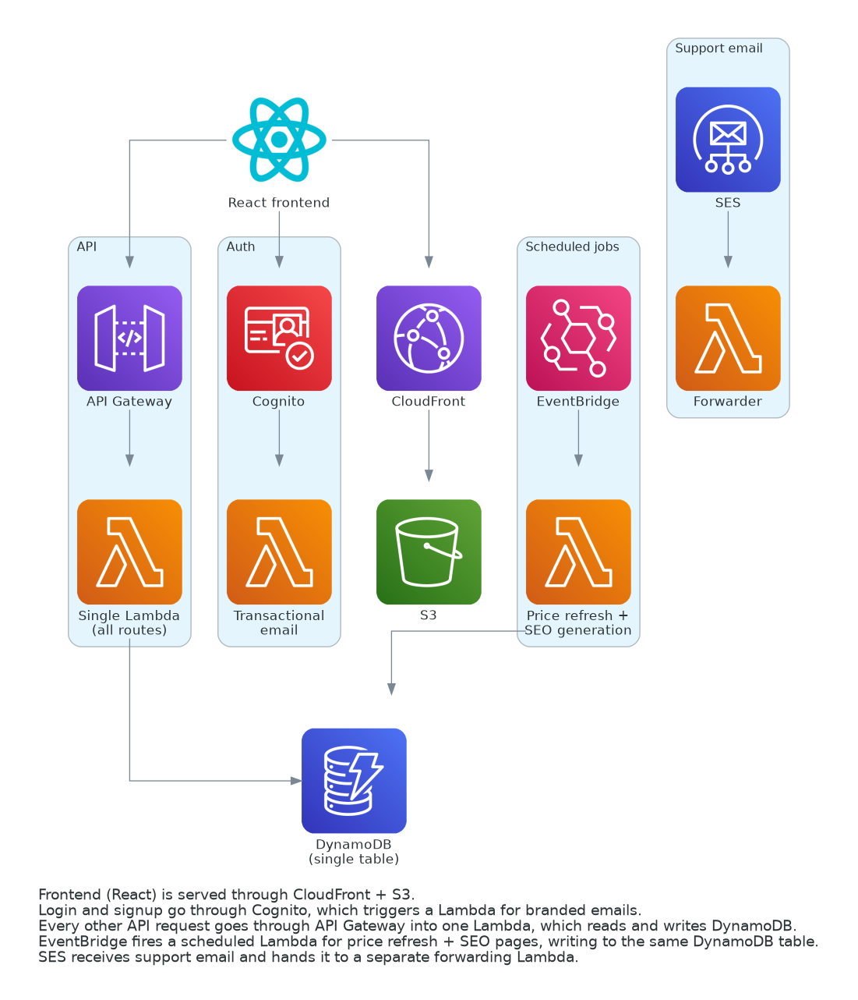

# Mint or Miss: Serverless TCG Price Tracker

A price tracking app for trading card games (Pokémon, Magic: The Gathering, Yu-Gi-Oh, One Piece, Lorcana, Gundam, and Riftbound). It shows live prices for raw and graded cards, lets people track their own collection, set price alerts, and calculates whether grading a card is actually worth the fee.

This repo is a cleaned-up writeup of the architecture, not the live production code. Real AWS account details, resource names, and some business logic have been removed or replaced with generic placeholders, since this is a real product I'm running.

---

## Architecture

**What's happening in this diagram:** the frontend is a React app. It's just static files, sitting in an S3 bucket, served through CloudFront, which caches the files closer to wherever the user actually is so pages load faster.

From there, the app does two main things.

If someone's logging in, signing up, or resetting a password, the frontend talks to Cognito. I hooked up a small Lambda function that runs whenever Cognito sends an email, so the signup code and password reset emails look like real branded emails instead of Cognito's plain default ones.

For everything else, like searching for a card's price, adding something to a collection, or checking billing, the frontend sends a request to API Gateway. API Gateway's job is simple: it takes the incoming request and hands it to a Lambda function. That one Lambda function handles every single API request the app has. Inside the code, it looks at the URL path to figure out what the user is actually asking for, then reads or writes to DynamoDB, which is the database.

Two more pieces run on their own, without anyone using the app. EventBridge fires a Lambda function on a timer to refresh card prices and generate some static pages for search engines. And separately, when someone emails the support address, SES receives it and hands it off to a small Lambda that forwards it to my real inbox.

### Why I built it this way: cost

I'm one person building this, not a funded company with a team and a budget. Traffic is small and unpredictable, so I didn't want to pay for a server sitting there 24/7 waiting for someone to show up.

Everything in this stack only costs money when it's actually used. Lambda functions only run (and only get billed) when a request comes in. DynamoDB's on-demand pricing works the same way. CloudFront only charges for what actually gets served. When nobody's using the app, the cost is close to nothing. That was the main reason I picked this setup over something like running my own server or a container that has to stay running all the time.

The tradeoff is real too, and worth being honest about. Lambda functions can be a little slower on the very first request after sitting idle for a while ("cold start"), and each function can only run for a maximum of 15 minutes. Neither of those has actually caused a problem at the traffic level this app gets, so the cost savings have been worth it.

---

## A few decisions I'd explain if asked

### Why one big Lambda function instead of a bunch of small ones

Every single API route (searching, managing a collection, alerts, billing) goes through the same one Lambda function. Inside that function, the code checks the request's path and decides what to do, kind of like a big if/else chain.

I could have built a separate Lambda for every feature instead. I didn't, because that means way more things to manage: more functions to deploy, more permission settings, more log groups to go check when something breaks. One function is simpler to reason about while the app is still small. If it ever needed to scale a lot, splitting things up might make more sense later, but it wasn't worth that complexity yet.

### Why everything's in one DynamoDB table

DynamoDB isn't like a normal SQL database. You can't join tables together the way you can in something like MySQL or Postgres. So instead of having a separate table for users, a separate table for cards, a separate table for price history, and so on, I put everything into one table. I tell different types of data apart by how I name the ID (like `PROFILE#userid` for a user's profile, or `SNAPSHOT#cardid#timestamp` for a price history entry).

**A real bug this caused, and what I learned from it:** at one point, some users' portfolio value charts were showing way higher numbers than they should have. It turned out some internal tracking records, things like rate-limit counters and search caches, had accidentally gotten tagged with a user's ID for bookkeeping reasons. A query that was supposed to only grab someone's actual cards wasn't filtering those out, so it was adding them into the total value by mistake.

The fix was straightforward once I found it: make the query explicitly skip anything that isn't actually a card. But the real lesson was bigger than that one bug. When everything lives in one table, it's really easy for a query to accidentally grab something it wasn't supposed to. Now I'm a lot more careful to be explicit about exactly what a query should include, not just assume it'll only grab what I meant.

### A tricky bug around combining data from different users

I built a feature that shows the biggest price movers across everyone's collections, not just one person's. The problem: if two different people both own the same real card, each person's copy is still its own separate row in the database with its own separate ID, because ownership is tracked per person.

At first I tried grouping the data by that row's own ID, and it didn't work right, because two different people's copies of the exact same card never matched up. Each one just looked like an unrelated data point.

The fix was to group by the card's actual identity instead (like its catalog number), not by whichever database row happened to be tracking it. Once I did that, two different people's copies of the same card correctly got treated as the same card. That's a pattern I'd now recognize faster if I ran into something similar again: if data is stored separately per user but actually represents the same real-world thing, you have to group by what that thing actually is, not by the ID of whoever's record you're looking at.

### Why the deploy pipeline matches how this project actually deploys

The GitHub Actions pipeline checks the code for real errors (Python syntax problems, broken JSX, invalid HTML) every time someone opens a pull request, before anything can get merged. Once it's merged, it deploys automatically: it updates the Lambda function's code, syncs the frontend files to S3, and clears the CloudFront cache so people actually see the new version.

I built the deploy step to match the actual commands this project uses to deploy, instead of grabbing a generic template built around a different tool (like Terraform) that this project doesn't even use. If I'd just copied a common template without checking, it probably would have failed immediately, looking for infrastructure that was never set up that way.

The credentials the pipeline uses are also limited on purpose. They can only touch the one Lambda function, the one S3 bucket, and the one CloudFront distribution this project actually needs. Not full access to my AWS account. That way, if those credentials ever leaked, the damage someone could do with them is small and specific, not "access to everything."

---

## Stack

- **Compute:** AWS Lambda (Python)
- **Data:** DynamoDB, one table for everything
- **Auth:** Amazon Cognito, with a custom Lambda for branded emails
- **Frontend:** React (loaded directly in the browser, no build step), hosted on S3 and CloudFront
- **Email:** SES for sending emails out and receiving support emails in
- **Scheduling:** EventBridge triggers a Lambda on a timer for price updates and SEO pages
- **CI/CD:** GitHub Actions checks every pull request automatically, then deploys automatically once merged

---

## About infrastructure as code

This project's resources were originally defined in Terraform, and those `.tf` files are still in the full project history. The day-to-day deploy pipeline in this repo doesn't apply them though. It updates the Lambda code, syncs the frontend, and invalidates the CDN cache directly through the AWS CLI instead.

That was a deliberate choice for a fast-moving, one-person project. Keeping Terraform's state file perfectly in sync with every small change added more overhead than it was worth at this size and pace. For a bigger team, or infrastructure that changes less often and needs to stay identical across environments, using Terraform as the actual source of truth would make a lot more sense. I'd reach for it there. For this project, right now, it didn't pay for itself.

---

## What's not in this repo

Real AWS account IDs, resource names, API keys, and some of the actual pricing and business logic have been left out or replaced with placeholders on purpose. This is a real product people use. This repo is meant to show how it's built and why, not to be something anyone could actually deploy as-is.
